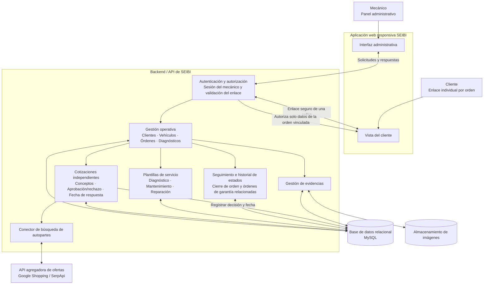
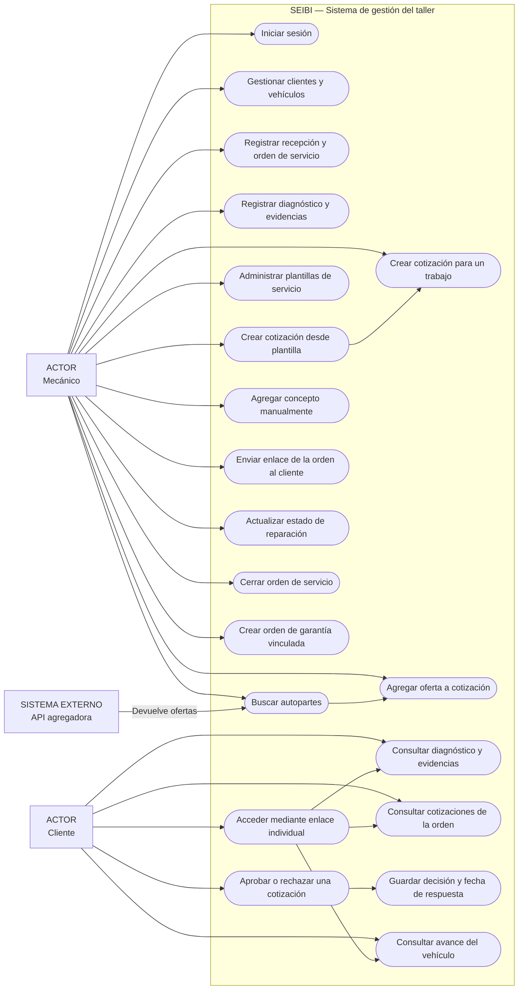
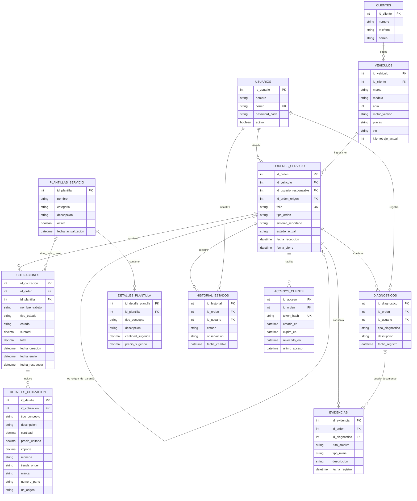

<div align="center">

# 🚗 SEIBI
### Sistema de Gestión de Taller Mecánico & Cotizador Inteligente de Autopartes

[](https://laravel.com)
[](https://php.net)
[](https://tailwindcss.com)
[](https://mysql.com)
[](https://www.figma.com/design/PnxTdqqoSwtksCPH4iU0ay/Sin-t%C3%ADtulo?node-id=20-422&t=oQTyS8JAg6EfOdSp-1)

---

### 📋 Portada de Identificación del Proyecto

| Dato | Información |
| :--- | :--- |
| **Nombre del Alumno** | **Cesar Abraham Echavarria Perez** |
| **Grado y Grupo** | **9A** |
| **Equipo** | **Equipo 10** |
| **Sistema** | **SEIBI — Plataforma de Gestión Automotriz** |
| **Prototipo / Figma** | [🔗 Ver Diseño en Figma](https://www.figma.com/design/PnxTdqqoSwtksCPH4iU0ay/Sin-t%C3%ADtulo?node-id=20-422&t=oQTyS8JAg6EfOdSp-1) |

---

</div>

> **Plataforma web integral para talleres mecánicos independientes:** Centralización de clientes y vehículos, elaboración ágil de cotizaciones, seguimiento de órdenes de servicio y buscador multifuente de autopartes.

---

## 📑 Tabla de Contenidos

### 📌 [Rúbrica 1](#rúbrica-1)
1. [Planteamiento del Problema](#1-planteamiento-del-problema)
2. [Justificación del Proyecto](#2-justificación-del-proyecto)
   - [2.1. Impacto Operativo y Comercial](#21-impacto-operativo-y-comercial)
   - [2.2. Impacto para el Cliente](#22-impacto-para-el-cliente)
3. [Objetivos del Proyecto](#3-objetivos-del-proyecto)
   - [3.1. Objetivo General](#31-objetivo-general)
   - [3.2. Objetivos Específicos](#32-objetivos-específicos)
4. [Alcance del Proyecto](#4-alcance-del-proyecto)
5. [Limitaciones del Proyecto](#5-limitaciones-del-proyecto)
6. [Producto Mínimo Viable (MVP)](#6-producto-mínimo-viable-mvp)
   - [6.1. Funcionalidades Indispensables (P1)](#61-funcionalidades-indispensables)
   - [6.2. Funcionalidades Complementarias (P2)](#62-funcionalidades-complementarias-sujetas-al-avance)
7. [Requisitos del Sistema](#7-requisitos-del-sistema)
   - [7.1. Requisitos Funcionales](#71-requisitos-funcionales)
   - [7.2. Requisitos No Funcionales](#72-requisitos-no-funcionales)
8. [Análisis de Riesgos](#8-análisis-de-riesgos)
   - [8.1. Matriz de Riesgos](#81-matriz-de-riesgos)
9. [Metodología de Desarrollo y Responsabilidades](#9-metodología-de-desarrollo-y-responsabilidades)
   - [9.1. Metodología Propuesta](#91-metodología-propuesta)
   - [9.2. Iteraciones de Trabajo](#92-iteraciones-de-trabajo)
   - [9.3. Responsabilidades del Equipo](#93-responsabilidades-del-equipo)
   - [9.4. Distribución de Responsabilidades](#94-distribución-de-responsabilidades)
10. [Desglose de Tareas y Estimaciones](#10-desglose-de-tareas-y-estimaciones)
    - [10.1. Lista de Tareas](#101-lista-de-tareas)
11. [Cronograma de Seis Semanas](#11-cronograma-de-seis-semanas)
    - [11.1. Calendario de Trabajo](#111-calendario-de-trabajo)
    - [11.2. Control Semanal](#112-control-semanal)
12. [Arquitectura, Tecnologías y Patrones de Diseño](#12-arquitectura-tecnologías-y-patrones-de-diseño)
    - [12.1. Arquitectura Propuesta](#121-arquitectura-propuesta)
    - [12.2. Tecnologías](#122-tecnologías)
    - [12.3. Patrones de Diseño](#123-patrones-de-diseño)
13. [Wireframes de las Pantallas Principales](#13-wireframes-de-las-pantallas-principales)
14. [Definición e Inventario de Contenido](#14-definición-e-inventario-de-contenido)
    - [14.1. Inventario de Contenido](#141-inventario-de-contenido)
    - [14.2. Criterios de Comunicación](#142-criterios-de-comunicación)

---

### 📌 [Rúbrica 2](#rúbrica-2)
15. [Control de Versiones y Plataforma de Alojamiento](#15-control-de-versiones-y-plataforma-de-alojamiento)
    - [15.1. Sistema de Control de Versiones: Git](#151-sistema-de-control-de-versiones-git)
    - [15.2. Plataforma de Alojamiento: GitHub](#152-plataforma-de-alojamiento-github)
16. [Flujo de Trabajo con GitHub Flow](#16-flujo-de-trabajo-con-github-flow)
    - [16.1. Rama Principal (main)](#161-rama-principal-main)
    - [16.2. Nomenclatura de Ramas](#162-nomenclatura-de-ramas)
    - [16.3. Convención de Commits](#163-convención-de-commits)
    - [16.4. Gestión de Pull Requests](#164-gestión-de-pull-requests)
    - [16.5. Política de Combinación de Ramas](#165-política-de-combinación-de-ramas)
    - [16.6. Protección y Mantenimiento del Repositorio](#166-protección-y-mantenimiento-del-repositorio)
17. [Configuración y Parámetros del Entorno de Versiones](#17-configuración-y-parámetros-del-entorno-de-versiones)
    - [17.1. Parámetros Iniciales de Git](#171-parámetros-iniciales-de-git)
    - [17.2. Control de Accesos y Protección de Ramas](#172-control-de-accesos-y-protección-de-ramas)
    - [17.3. Configuración del Archivo .gitignore](#173-configuración-del-archivo-gitignore)
    - [17.4. Gestión de Credenciales y Autenticación](#174-gestión-de-credenciales-y-autenticación)
    - [17.5. Verificación y Mantenimiento de la Configuración](#175-verificación-y-mantenimiento-de-la-configuración)
18. [Diagramas del Sistema](#18-diagramas-del-sistema)
    - [18.1. Decisiones de Diseño Aplicadas](#181-decisiones-de-diseño-aplicadas)
    - [18.2. Arquitectura del Sistema](#182-arquitectura-del-sistema)
    - [18.3. Diagrama de Casos de Uso](#183-diagrama-de-casos-de-uso)
    - [18.4. Diagrama Entidad-Relación (DER)](#184-diagrama-entidad-relación-der)
    - [18.5. Reglas de Negocio del Modelo de Datos](#185-reglas-de-negocio-del-modelo-de-datos)
    - [18.6. Consideraciones Técnicas](#186-consideraciones-técnicas)
19. [Diccionario de Datos](#19-diccionario-de-datos)
    - [19.1. Descripción General y Convenciones](#191-descripción-general-y-convenciones)
    - [19.2. Estructura de Tablas de la Base de Datos](#192-estructura-de-tablas-de-la-base-de-datos)
    - [19.3. Relaciones entre las Tablas](#193-relaciones-entre-las-tablas)
    - [19.4. Reglas de Integridad y Validación](#194-reglas-de-integridad-y-validación)

---

<a id="rubrica-1"></a>
# Rúbrica 1

---

## 1. Planteamiento del Problema

En los talleres mecánicos independientes, el registro de clientes, vehículos, diagnósticos, cotizaciones y avances de reparación suele mantenerse de forma fragmentada en documentos físicos, hojas de cálculo o aplicaciones de mensajería instantánea. Esta dispersión genera múltiples fricciones operativas:

- **Desorganización de expedientes:** Dificultad para consultar el historial de servicio acumulado por cada vehículo de manera centralizada.
- **Búsqueda lenta e ineficiente de refacciones:** Al cotizar, el personal debe navegar en múltiples tiendas en línea y plataformas comerciales, copiando manualmente descripciones, precios, números de parte y enlaces. Al cotizar múltiples refacciones, el proceso se vuelve repetitivo, propiciando demoras e inconsistencias en la captura.
- **Riesgo de incompatibilidad:** Piezas con funciones similares no siempre son compatibles entre distintas versiones o motorizaciones. Una búsqueda general no garantiza que el componente sea apto; la compatibilidad final exige validación técnica humana antes de confirmar el presupuesto.
- **Falta de certidumbre para el cliente:** Presupuestos poco desglosados y la ausencia de información en tiempo real sobre el avance de la reparación generan desconfianza e incrementan las llamadas recurrentes solicitando actualizaciones.
---

## 2. Justificación del Proyecto

El proyecto surge de la necesidad de optimizar los procesos operativos de un taller mecánico mediante la centralización de la información y la automatización de tareas administrativas. Se busca reducir el tiempo invertido en la elaboración de cotizaciones, especialmente durante la búsqueda de refacciones en diferentes tiendas y plataformas digitales.

Para ello, se propone integrar un buscador multifuente de autopartes que permita consultar distintas opciones comerciales desde un mismo lugar, facilitando la comparación de precios y la selección de piezas adecuadas para cada vehículo. De esta manera, **SEIBI** pretende agilizar el trabajo del personal, reducir la captura manual de información y mejorar la organización y claridad de las cotizaciones entregadas a los clientes.

### 2.1. Impacto Operativo y Comercial
- **Centralización total:** La gestión de clientes y vehículos en una base de datos relacional permite recuperar expedientes completos desde una sola plataforma.
- **Agilidad en la consulta:** El buscador multifuente minimiza la apertura simultánea de pestañas y la recaptura de datos.
- **Trazabilidad de ofertas:** Al seleccionar una refacción comercial, sus datos (precio de referencia, origen y enlace) se integran directamente a la línea de cotización.

### 2.2. Impacto para el Cliente
- **Presupuestos claros y desglosados:** Visualización separada de refacciones, mano de obra, subtotales y total estimado.
- **Transparencia y evidencia:** Posibilidad de anexar notas explicativas y fotografías diagnósticas como respaldo del servicio.
- **Portal de seguimiento:** Consulta del presupuesto y del estatus de la orden mediante un enlace seguro de solo lectura, reduciendo consultas redundantes por teléfono o chat.

---

## 3. Objetivos del Proyecto

### 3.1. Objetivo General
Desarrollar una aplicación web responsiva para apoyar la gestión de un taller mecánico mediante el registro de clientes y vehículos, la elaboración de cotizaciones y el seguimiento básico de órdenes de servicio, incorporando un buscador multifuente de autopartes que reduzca el trabajo manual de búsqueda y captura y facilite la revisión de opciones comerciales por parte del personal.

### 3.2. Objetivos Específicos
- **Centralizar la información:** Implementar el registro y la consulta de clientes y vehículos, incluyendo marca, modelo, año, motorización y notas relevantes del historial de servicio.
- **Agilizar la cotización:** Permitir agregar refacciones y mano de obra, editar cantidades y precios, calcular subtotales y total, y conservar los datos de las ofertas seleccionadas como referencia.
- **Integrar el buscador de autopartes:** Consultar una API agregadora a partir de los datos del vehículo y el nombre de la pieza, mostrar en un formato uniforme los campos disponibles y permitir seleccionar una oferta para incorporarla a la cotización.
- **Apoyar la revisión de compatibilidad:** Mostrar los datos del vehículo y los identificadores de la pieza que la fuente proporcione, cuando estén disponibles, indicando que la compatibilidad final debe ser confirmada por el personal del taller.
- **Facilitar la comunicación:** Permitir adjuntar una imagen de evidencia a una orden y actualizar su estado mediante etapas predefinidas que el cliente pueda consultar con un enlace de solo lectura.
- **Diseñar una interfaz responsiva:** Procurar que las pantallas principales puedan utilizarse desde computadoras y teléfonos mediante un navegador web.

---

## 4. Alcance del Proyecto

El proyecto comprende el diseño, desarrollo y puesta en marcha de un prototipo web responsivo para gestionar la operativa básica del taller y agilizar la cotización.

### Funcionalidades contempladas en la primera versión:
- **Acceso administrativo:** Autenticación protegida para el personal responsable del taller.
- **Gestión de clientes y vehículos:** CRUD (creación, lectura, actualización y eliminación) con vinculación directa entre propietarios y vehículos.
- **Órdenes y cotizaciones:** Creación de presupuestos con cálculo automático de totales (piezas + mano de obra) vinculados al historial del vehículo.
- **Buscador inteligente y multifuente de autopartes:** Consulta comercial combinada (marca, modelo, año, motorización + pieza) mediante una API agregadora (como SerpApi / Google Shopping), normalizando campos como título, comercio, precio, moneda, imagen y enlace.
- **Selección e incorporación ágil:** Traspaso directo de la oferta comercial a la línea de cotización guardando una copia estática de los datos de referencia, con fallback a captura manual.
- **Evidencia y seguimiento básico:** Registro de estados del servicio (*Recepción*, *Diagnóstico*, *Esperando refacción*, *En reparación*, *Listo para entrega*) y carga de imagen diagnóstica (JPG/PNG).
- **Portal de cliente:** Acceso web de solo lectura a través de token/enlace único para consulta de avance y cotización.

---

## 5. Limitaciones del Proyecto

Para asegurar la entrega en un desarrollo individual en el plazo estimado de 6 semanas, se establecen las siguientes delimitaciones:

| Área | Fuera de Alcance | Alternativa / Enfoque Adoptado |
| :--- | :--- | :--- |
| **Inventario físico** | No incluye control de almacén, stock físico ni órdenes de compra automáticas. | La búsqueda comercial se utiliza exclusivamente como catálogo de referencia y cotización. |
| **Integraciones API** | No se desarrollarán conexiones directas independientes por tienda (Amazon, Mercado Libre, AutoZone). | Se utiliza una única API agregadora comercial (ej. SerpApi / Google Shopping). |
| **Compatibilidad automática** | Sin decodificación VIN automatizada ni catálogo propio de cruce de números OE/OEM. | Se presentan los datos del vehículo y de la pieza para validación y confirmación del mecánico. |
| **Precios y disponibilidad** | Sin sincronización en vivo posterior al guardado. | Se almacena una instantánea del precio consultado; el personal puede ajustar precios manualmente. |
| **Pasarelas de pago y fiscal** | Sin cobro con tarjeta, TPV ni emisión de facturas fiscales (CFDI). | Generación de cotizaciones informativas y presupuestos de servicio. |
| **Aplicación nativa** | Sin aplicaciones móviles nativas para iOS o Android. | Diseño web 100% responsivo adaptable a navegadores de escritorio y móviles. |
| **Servicios externos** | Dependencia de cuotas y disponibilidad de la API comercial. | Captura manual siempre disponible como mecanismo de contingencia. |
| **Funciones avanzadas diferidas** | Sin WebSockets, recordatorios programados por WhatsApp/SMS o video diagnóstico. | Evaluables para versiones posteriores tras consolidar el núcleo del sistema. |

---

## 6. Producto Mínimo Viable (MVP)

El MVP se estructura en dos fases de prioridad para salvaguardar la viabilidad del proyecto:

### 6.1. Funcionalidades Indispensables (P1)
1. **Autenticación administrativa:** Control de acceso seguro al panel de gestión.
2. **Gestión integral de clientes y vehículos:** Registro y consulta relacional con ficha técnica básica.
3. **Buscador multifuente de autopartes:** Conexión con una API agregadora con presentación normalizada.
4. **Incorporación a cotización y captura manual:** Selección rápida de ofertas de la API o registro manual alternativo ante fallos o ausencias de resultados.
5. **Generador y calculador de cotizaciones:** Cálculo automático de subtotales, mano de obra y totales.
6. **Almacenamiento persistente:** Historial de cotizaciones asociadas al cliente y vehículo.

### 6.2. Funcionalidades Complementarias Sujetas al Avance (P2)
1. **Evidencia fotográfica:** Subida de al menos una fotografía (JPG/PNG) del diagnóstico.
2. **Seguimiento del servicio para clientes:** Enlace web público de solo lectura con estados predefinidos de la orden.
---

## 7. Requisitos del Sistema

### 7.1. Requisitos Funcionales

| ID | Requisito Funcional | Criterio de Aceptación | Prioridad |
| :--- | :--- | :--- | :---: |
| **RF-01** | **Autenticación administrativa**<br>El sistema deberá permitir que el usuario administrador inicie sesión y bloquear las funciones de gestión cuando no exista una sesión válida. | Un usuario no autenticado no puede acceder a las pantallas ni acciones administrativas. | **P1** |
| **RF-02** | **Gestión de clientes**<br>El administrador podrá registrar, consultar, editar y eliminar los datos necesarios del cliente. | Los cambios se guardan en la base de datos y se reflejan al volver a consultar el registro. | **P1** |
| **RF-03** | **Gestión de vehículos**<br>Cada vehículo deberá estar relacionado con un cliente y guardar, como mínimo, marca, modelo, año y motorización, además de notas opcionales. | El sistema permite crear y consultar vehículos y muestra su relación con el cliente correcto. | **P1** |
| **RF-04** | **Gestión de órdenes y cotizaciones**<br>El administrador podrá crear una cotización vinculada a un cliente y un vehículo, así como consultar las cotizaciones guardadas. | Cada cotización conserva la relación con su cliente y vehículo. | **P1** |
| **RF-05** | **Búsqueda multifuente**<br>El sistema consultará una API agregadora a partir del nombre o tipo de refacción y los datos del vehículo disponibles. | Al enviar una búsqueda válida, la aplicación presenta resultados de la API o informa claramente que no hubo resultados o que ocurrió un error. | **P1** |
| **RF-06** | **Presentación uniforme de resultados**<br>Los resultados se mostrarán en un formato común con los campos disponibles, tales como título del producto, comercio, precio, moneda, enlace, imagen y número de parte. | Los campos ausentes no rompen la pantalla ni se sustituyen por datos inventados. | **P1** |
| **RF-07** | **Selección de una oferta**<br>El administrador podrá elegir un resultado y agregarlo a una cotización. Se guardará una copia de los datos disponibles en el momento de la selección, incluido el precio consultado y el enlace de origen. | La pieza seleccionada aparece como línea de cotización con su información recuperada. | **P1** |
| **RF-08** | **Captura manual alternativa**<br>El administrador podrá agregar una refacción manualmente si la API no devuelve resultados o no está disponible. | La creación de una cotización puede completarse sin depender de la respuesta del proveedor externo. | **P1** |
| **RF-09** | **Cálculo de cotización**<br>El administrador podrá especificar cantidad y precio de refacciones y mano de obra; el sistema calculará los importes y el total. | Al modificar cantidad o precio, subtotales y total se actualizan correctamente. | **P1** |
| **RF-10** | **Notas de cotización**<br>El administrador podrá agregar una nota aclaratoria al presupuesto. | La nota se guarda y aparece al consultar la cotización. | **P1** |
| **RF-11** | **Seguimiento del servicio**<br>El administrador podrá cambiar el estado de una orden entre estados predefinidos. El cliente podrá consultar la cotización y el estado mediante un enlace de solo lectura. | El estado actualizado se muestra al volver a abrir el enlace; el cliente no puede editar la información. | **P2** |
| **RF-12** | **Evidencia fotográfica**<br>El sistema permitirá adjuntar al menos una imagen JPG o PNG a una orden. | Una imagen válida se guarda y puede visualizarse al consultar la orden; un archivo no permitido se rechaza con un mensaje comprensible. | **P2** |

---

### 7.2. Requisitos No Funcionales

| ID | Requisito No Funcional | Criterio de Aceptación | Prioridad |
| :--- | :--- | :--- | :---: |
| **RNF-01** | **Diseño responsivo**<br>Las pantallas principales deberán adaptarse a escritorio y móvil mediante navegador web. | El formulario de búsqueda y la cotización pueden utilizarse en una pantalla móvil sin desplazamiento horizontal de toda la página. | **P1** |
| **RNF-02** | **Protección de credenciales y acceso**<br>Las rutas administrativas deberán validar la sesión en el servidor; las claves de la API externa no se expondrán en el frontend ni en el repositorio público. | Las pantallas privadas no son accesibles sin iniciar sesión y la clave del proveedor solo se utiliza desde el backend. | **P1** |
| **RNF-03** | **Validación de datos**<br>Los formularios deberán validar los campos obligatorios, formatos y valores numéricos antes de guardar. | Los formularios muestran mensajes ante campos requeridos vacíos o cantidades y precios inválidos. | **P1** |
| **RNF-04** | **Manejo de fallos externos**<br>La aplicación deberá informar cuando la búsqueda externa no responda, falle o no encuentre resultados y conservar disponible la captura manual. | El error de la API no bloquea la creación ni el guardado de una cotización manual. | **P1** |
| **RNF-05** | **Integridad de la cotización**<br>Los importes se calcularán con valores numéricos y las cotizaciones guardadas conservarán los datos que se seleccionaron. | Las pruebas con cantidades y precios conocidos producen los subtotales y totales esperados; la cotización existente no cambia si después cambia la publicación externa. | **P1** |
| **RNF-06** | **Separación de la integración**<br>Las llamadas a la API se realizarán desde el backend y se mantendrán separadas de la lógica de cotización. | La búsqueda puede adaptarse a otro proveedor modificando el módulo de integración, sin reconstruir el cálculo de cotizaciones. | **P1** |
| **RNF-07** | **Claridad sobre precios y compatibilidad**<br>La aplicación presentará el origen y el precio consultado cuando esos datos estén disponibles y no afirmará compatibilidad automática sin respaldo de una fuente confiable. | La interfaz indica que la compatibilidad debe ser confirmada por el personal del taller y que los datos comerciales pueden cambiar. | **P1** |
| **RNF-08** | **Privacidad del acceso del cliente**<br>El enlace de consulta deberá permitir únicamente lectura de la orden correspondiente y no exponer datos de otras órdenes. | Un enlace de prueba solo muestra la información de la orden asociada y no ofrece acciones de edición. | **P2** |
| **RNF-09** | **Rendimiento de pantallas internas**<br>En el entorno de prueba y con un conjunto de hasta 100 clientes y vehículos, las pantallas que consulten datos locales deberán responder en menos de 3 segundos, sin contar el tiempo de respuesta de la API externa. | Se mide la carga de las pantallas principales en una prueba local documentada. | **P2** |

---

## 8. Análisis de Riesgos

El análisis prioriza los eventos que podrían amenazar el flujo principal dentro de las seis semanas de desarrollo individual.

### 8.1. Matriz de Riesgos

| ID | Riesgo | Prob. | Impacto | Prevención y Mitigación | Plan de Contingencia |
| :---: | :--- | :---: | :---: | :--- | :--- |
| **R-01** | La API no ofrece resultados suficientes o acceso viable. | **Alta** | **Alto** | Probar búsquedas reales en la semana 1 y revisar campos, límites, costos y condiciones. | Evaluar otra API y conservar captura manual; no simular resultados reales. |
| **R-02** | La integración o el crecimiento del alcance retrasa el desarrollo. | **Alta** | **Alto** | Aislar la API; mantener búsqueda, selección y cotización como P1; posponer extras. | Entregar el flujo principal y dejar documentadas las funciones P2. |
| **R-03** | Se selecciona una pieza incompatible con el vehículo. | **Media** | **Alto** | Incluir datos del vehículo y número de parte si existe; exigir revisión del mecánico. | Advertir que la búsqueda no certifica compatibilidad y permite corregir la línea. |
| **R-04** | Hay errores de cálculo o relaciones incorrectas entre datos. | **Media** | **Alto** | Validar formularios y probar cantidades, precios, subtotales, totales y relaciones. | Corregir antes de entregar; mantener cotizaciones guardadas editables. |
| **R-05** | Se expone una clave de API o un cliente accede a otra orden. | **Media** | **Alto** | Proteger rutas, guardar claves en variables de entorno del servidor y limitar cada enlace a una orden. | Rotar credenciales si es necesario y comprobar que los enlaces no permiten acceder a otros registros. |
| **R-06** | El tiempo disponible se reduce por estudio, trabajo o problemas técnicos. | **Alta** | **Alto** | Usar hitos semanales, revisar avances y reservar los últimos días para pruebas. | Aplazar primero evidencia fotográfica y seguimiento P2; no sacrificar búsqueda, captura manual ni cálculo correcto. |

---

## 9. Metodología de Desarrollo y Responsabilidades

### 9.1. Metodología Propuesta
Se propone un enfoque **iterativo e incremental con organización Kanban**. El trabajo se estructura en bloques pequeños, priorizados por su aporte al flujo principal y validados antes de continuar.

- **Estados del Tablero Kanban:** `Pendiente` ➔ `En Proceso` ➔ `En Revisión / Pruebas` ➔ `Terminado`
- **Límite de WIP (Work in Progress):** Máximo 1 o 2 tareas simultáneas para evitar dispersión.
- **Revisiones periódicas:** Evaluación semanal contra los hitos del cronograma.

### 9.2. Iteraciones de Trabajo

| Iteración | Actividades Principales | Resultado Verificable |
| :---: | :--- | :--- |
| **1. Preparación** | Validar API; cerrar requisitos; modelo de datos; wireframes y configuración inicial. | Prueba de API documentada, diagrama de datos y proyecto ejecutable. |
| **2. Gestión Básica** | Autenticación y CRUD de clientes y vehículos. | Registros guardados y relacionados correctamente. |
| **3. Cotizaciones** | Órdenes, líneas de refacción, mano de obra y cálculo; consulta manual. | Cotización guardada y totales comprobados. |
| **4. Buscador** | Conector con proveedor, pantalla de resultados, selección de oferta y captura de referencia. | Una oferta puede convertirse en una línea de cotización. |
| **5. Complementos** | Diseño responsivo, evidencia fotográfica y seguimiento básico si el núcleo funciona. | Pantallas utilizables en móvil; funciones complementarias verificadas. |
| **6. Cierre** | Pruebas de flujo, seguridad, corrección de errores y preparación de entrega. | Versión demostrable, lista de pruebas y guía breve de instalación. |

### 9.3. Responsabilidades del Equipo
El proyecto será desarrollado de manera individual por **Cesar Abraham Echavarria Perez** (Grado 9A, Equipo 10), asumiendo las responsabilidades integrales de análisis, planificación, diseño, desarrollo, pruebas, aseguramiento de calidad y documentación técnica del sistema.

### 9.4. Distribución de Responsabilidades

| Responsabilidad / Área | Tareas Principales |
| :--- | :--- |
| **Análisis, Coordinación y Diseño** | Definir requisitos, priorizar tareas, actualizar el tablero, preparar wireframes y documentar decisiones. |
| **Desarrollo e Integración** | Implementar pantallas, lógica de negocio, base de datos y conexión con la API externa. |
| **Pruebas, Calidad y Entrega** | Ejecutar criterios de aceptación, revisar permisos, corregir defectos y preparar la demostración e instrucciones. |

---

## 10. Desglose de Tareas y Estimaciones

Estimaciones calculadas en días laborables de desarrollo individual. Ante desviaciones, se priorizarán estrictamente las tareas P1 aplazando P2 para no comprometer el flujo principal.

### 10.1. Lista de Tareas

| ID | Tarea | Esfuerzo Estimado | Dependencias | Criterio de Terminado |
| :---: | :--- | :---: | :---: | :--- |
| **T-01** | Prueba de viabilidad de la API agregadora. | 1 día | Ninguna | Consulta real ejecutada; campos, límites, acceso y riesgos anotados. |
| **T-02** | Cerrar requisitos, modelo de datos y wireframes. | 2 días | T-01 (en paralelo) | Documento y navegación de pantallas definidos; entidades y relaciones revisadas. |
| **T-03** | Crear proyecto, configurar entorno y autenticación. | 2 días | T-02 | El sistema se ejecuta e impide acceso administrativo sin sesión. |
| **T-04** | Implementar CRUD de clientes y vehículos. | 2 días | T-03 | Crear, consultar, editar y eliminar registros relacionados; validaciones básicas activas. |
| **T-05** | Implementar órdenes, cotizaciones y cálculo manual. | 3 días | T-04 | Guardar cotización y comprobar importes con casos conocidos. |
| **T-06** | Crear servicio de backend para consultar la API. | 2 días | T-01, T-03 | El backend consulta la fuente sin exponer la clave al navegador. |
| **T-07** | Diseñar resultados normalizados del buscador. | 2 días | T-06 | Se muestran resultados aunque falten campos opcionales. |
| **T-08** | Agregar oferta a cotización y captura manual alternativa. | 2 días | T-05, T-07 | La oferta queda guardada como referencia y la cotización funciona si falla la API. |
| **T-09** | Implementar evidencia y seguimiento básico. | 3 días | T-05 | Si hay tiempo disponible: imagen válida, estado actualizado y consulta de solo lectura probados. |
| **T-10** | Ajustar interfaz responsiva, probar el flujo y preparar la entrega. | 7 días | T-04, T-07, T-08 | Búsqueda y cotización utilizables en móvil y escritorio; criterios P1 verificados, defectos resueltos y demo lista. |

---

## 11. Cronograma de Seis Semanas

### 11.1. Calendario de Trabajo

| Semana | Actividades Principales | Hito / Entregable |
| :---: | :--- | :--- |
| **Semana 1** | Probar la API; cerrar requisitos y modelo de datos; elaborar wireframes; crear el proyecto y preparar el entorno. | **Hito 1:** Viabilidad técnica de búsqueda confirmada y base del proyecto ejecutable. |
| **Semana 2** | Implementar autenticación y gestión de clientes y vehículos. | **Hito 2:** Los datos básicos se guardan y consultan correctamente. |
| **Semana 3** | Desarrollar órdenes y cotizaciones manuales con líneas de piezas y mano de obra. | **Hito 3:** El cálculo de cotización funciona sin depender de la API. |
| **Semana 4** | Implementar el servicio de búsqueda, normalización de resultados y selección de ofertas. | **Hito 4:** Una oferta puede agregarse a una cotización guardada. |
| **Semana 5** | Integrar la búsqueda con la interfaz; ajustar diseño responsivo; añadir evidencia y seguimiento solo si el flujo P1 está estable. | **Hito 5:** Flujo principal completo y complementos desarrollados si el tiempo lo permite. |
| **Semana 6** | Pruebas de aceptación, seguridad y errores; solución de defectos; preparación de documentación y demostración. | **Hito 6:** Versión estable demostrable y criterios P1 verificados. |

### 11.2. Control Semanal
- **Inicio de semana:** Selección de tareas alcanzables y verificación de bloqueos/dependencias.
- **Fin de semana:** Demostración breve del incremento obtenido y actualización del tablero.
- **Desviaciones:** Si un hito se retrasa más de dos días laborales, se descartan o aplazan componentes P2 para salvaguardar la entrega.
- **Buenas prácticas:** Validar la API desde la primera semana y no postergar pruebas de cálculo para la fase final.

---

## 12. Arquitectura, Tecnologías y Patrones de Diseño

### 12.1. Arquitectura Propuesta
Se propone una **arquitectura monolítica modular bajo el patrón Modelo-Vista-Controlador (MVC)** sobre Laravel. Esta arquitectura simplifica el despliegue, disminuye costos de infraestructura y centraliza autenticación, lógica de cotización y acceso a datos en un solo código base sin la complejidad innecesaria de microservicios.

```
┌────────────────────────────────────────────────────────┐
│                   SEIBI Web (Blade)                    │
│             Tailwind CSS / Interfaz Móvil              │
└───────────────────────────▲────────────────────────────┘
                            │ HTTP
┌───────────────────────────▼────────────────────────────┐
│                    Laravel Backend                     │
│  ┌───────────────────────┐   ┌───────────────────────┐ │
│  │ Controladores & Rutas │   │ Modelos de Negocio    │ │
│  └───────────┬───────────┘   └───────────┬───────────┘ │
│              │                           │             │
│  ┌───────────▼───────────┐               │             │
│  │   PartSearchService   │               │             │
│  └───────────┬───────────┘               │             │
└──────────────┼───────────────────────────┼─────────────┘
               │ HTTP                      │ Eloquent ORM
       ┌───────▼───────┐           ┌───────▼───────┐
       │ API Comercial │           │  Base Datos   │
       │  (Agregador)  │           │     MySQL     │
       └───────────────┘           └───────────────┘
```

### 12.2. Tecnologías

| Componente | Tecnología Propuesta | Justificación |
| :--- | :--- | :--- |
| **Aplicación y Backend** | **Laravel (PHP)** | Gestiona rutas, validación, sesiones, reglas de negocio, almacenamiento de archivos y llamadas HTTP seguras desde el servidor. |
| **Interfaz Web** | **Blade + Tailwind CSS** *(Alpine.js opcional)* | Facilita componentes responsivos y modernos sin la sobrecarga de un framework SPA separado. |
| **Base de Datos** | **MySQL** | Motor relacional robusto para vincular clientes, vehículos, órdenes, líneas de cotización y piezas seleccionadas. |
| **Integración Comercial** | **Cliente HTTP Laravel + `PartSearchService`** | Centraliza la consulta externa, aislando credenciales en el servidor y transformando datos uniformemente. |
| **Almacenamiento de Archivos** | **Laravel Storage** | Gestión segura de evidencias fotográficas con validación de tipo MIME y tamaño de imagen. |
| **Control de Versiones** | **Git / GitHub** | Control de cambios, versionado y respaldo del desarrollo por fases. |

### 12.3. Patrones de Diseño
- **Modelo-Vista-Controlador (MVC):** Desacoplamiento claro entre la capa de presentación (Blade), lógica y control (Controllers) y persistencia (Eloquent Models).
- **Service Layer & Adapter (`PartSearchService`):** Clase de servicio dedicada a la comunicación con la API agregadora que transforma el payload externo al formato unificado de SEIBI, permitiendo cambiar de proveedor sin afectar la lógica de cotizaciones.

---

## 13. Wireframes de las Pantallas Principales

> [!TIP]
> **Prototipo Interactivo y Wireframes en Figma:**  
> Puedes consultar el diseño interactivo, los flujos y la distribución visual de las pantallas directamente en Figma:  
> 🔗 **[Abrir Proyecto de Wireframes en Figma](https://www.figma.com/design/PnxTdqqoSwtksCPH4iU0ay/Sin-t%C3%ADtulo?node-id=20-422&t=oQTyS8JAg6EfOdSp-1)**

---

### 13.1. Acceso y Panel Principal
- **Login administrativo:** Formulario simple y directo para validar credenciales del personal.
- **Dashboard del taller:** Tarjetas de acceso rápido apilables verticalmente en dispositivos móviles:
  - *Nuevo Cliente / Vehículo*
  - *Nueva Cotización*
  - *Órdenes Activas y Recientes*

### 13.2. Registro de Vehículo y Buscador de Autopartes
- **Ficha del vehículo:** Selector de cliente + campos: Marca, Modelo, Año, Motorización y Notas.
- **Buscador integrado:**
  - Barra de búsqueda de refacciones que hereda automáticamente los datos del vehículo seleccionado.
  - Cuícula de resultados: Título, imagen, tienda, precio y botón `[Agregar a Cotización]`.
  - Etiqueta de advertencia sobre confirmación técnica requerida por el mecánico.

### 13.3. Editor de Cotización y Consulta del Cliente
- **Editor administrativo:**
  - Tabla dinámica de conceptos: Refacciones añadidas (con enlace comercial y precio de referencia) y conceptos de Mano de Obra.
  - Campos de cantidad, precio unitario, subtotal y total calculado al vuelo.
  - Selector de estado de servicio y área para adjuntar imagen diagnóstica.
- **Vista pública del cliente:**
  - Enlace seguro sin permisos de edición.
  - Visualización del desglose de piezas, costo de mano de obra, notas del taller y barra de progreso del estado del vehículo.

---

## 14. Definición e Inventario de Contenido

### 14.1. Inventario de Contenido

| Elemento | Contenido Previsto | Origen / Consideración |
| :--- | :--- | :--- |
| **Nombre e Identidad** | Marca de trabajo: **SEIBI**; textos breves de navegación y títulos del sistema. | Nombre interno sujeto a evolución; no se usarán marcas de terceros como identidad del taller. |
| **Datos de Clientes** | Nombre, teléfono y correo estrictamente necesarios para el contacto y seguimiento. | Capturados exclusivamente por personal autorizado del taller. |
| **Datos del Vehículo** | Marca, modelo, año, motorización, placas y notas de historial de servicio. | Capturados en recepción; indispensables para afinar la búsqueda de refacciones. |
| **Resultados Comerciales** | Título de la pieza, comercio, precio, moneda, enlace directo e imagen (si existe). | Datos provistos por la API externa; respetando atribuciones, caché y límites del proveedor. |
| **Notas de Cotización** | Descripción del servicio, observaciones diagnósticas y aclaraciones de garantía. | Redactadas por el personal con lenguaje claro y comprensible para el cliente final. |
| **Estados de Servicio** | *Recepción*, *Diagnóstico*, *Esperando refacción*, *En reparación*, *Listo para entrega*. | Catálogo interno estándar y uniforme tanto en vista administrativa como pública. |
| **Evidencia Fotográfica** | Imágenes JPG o PNG de la pieza dañada o la zona de trabajo. | Fotografías tomadas por el taller; prohibido el uso de imágenes protegidas de terceros. |
| **Mensajes del Sistema** | Notificaciones de validación, errores de conexión con la API, confirmaciones de guardado. | Mensajes concisos, directos y accionables con orientación de cómo proseguir. |
| **Datos de Prueba** | Semillas de clientes, autos y cotizaciones ficticias (Seeders / Factories). | Identificados claramente como registros de testing para evitar confusiones. |

### 14.2. Criterios de Comunicación
- **Etiquetas claras y accionables:** Usar nombres directos en botones como *“Buscar refacción”*, *“Agregar a cotización”*, *“Guardar presupuesto”* y *“Actualizar estado”*.
- **Claridad monetaria:** Indicar la divisa explícitamente (ej. MXN) y evitar sumar monedas distintas sin conversión.
- **Alternativa permanente:** Si una búsqueda no arroja resultados o la API no responde, garantizar siempre la captura manual accesible.
- **Responsabilidad sobre compatibilidad:** Informar en la interfaz que las ofertas comerciales son de referencia y que la compatibilidad debe ser validada por el mecánico.
- **Desglose transparente:** Separar visiblemente costos de refacciones, mano de obra e importe total para máxima comprensión del cliente.

---

<a id="rubrica-2"></a>
# Rúbrica 2

---

## 15. Control de Versiones y Plataforma de Alojamiento

### 15.1. Sistema de Control de Versiones: Git
Se utilizará **Git** como sistema de control de versiones para registrar y administrar los cambios realizados durante el desarrollo de SEIBI. Esta herramienta permitirá:
- **Historial y trazabilidad:** Mantener un registro cronológico y detallado de todas las modificaciones.
- **Puntos de restauración:** Recuperar versiones anteriores y seguras ante posibles regresiones o fallos.
- **Desarrollo aislado:** Trabajar en ramas independientes para construir nuevas funcionalidades sin afectar directamente la versión principal y estable del sistema.

Su implementación facilitará el seguimiento de los cambios en los módulos de gestión vehicular, generación de cotizaciones y búsqueda multifuente de autopartes. Asimismo, permitirá identificar las modificaciones realizadas en cada etapa del desarrollo y mantener una estructura organizada del código fuente y los archivos de documentación.

### 15.2. Plataforma de Alojamiento: GitHub
Se utilizará **GitHub** como plataforma para alojar el repositorio remoto de SEIBI, el cual será público desde el inicio del desarrollo. Esta decisión permitirá centralizar el código fuente, la documentación técnica, los diagramas y los archivos de configuración en un mismo espacio, facilitando su consulta, seguimiento y mantenimiento.

La combinación de Git y GitHub permitirá implementar un flujo de trabajo basado en ramas, commits descriptivos y solicitudes de integración (*pull requests*) cuando se requiera revisar cambios antes de incorporarlos a la rama principal. Debido a que el desarrollo estará a cargo de una sola persona, se utilizará un flujo de trabajo simplificado que mantenga la trazabilidad de las modificaciones sin introducir procesos innecesarios.

> [!CAUTION]
> **Seguridad en Repositorio Público:** Al mantener el repositorio público, se establecerán medidas estrictas para evitar la exposición de información sensible. Los archivos de configuración locales, las contraseñas, las claves de API y los datos reales de clientes **no se incorporarán al repositorio**. Para ello, se utilizará un archivo `.gitignore` y se mantendrán las credenciales fuera del código fuente mediante variables de entorno.

En conjunto, Git y GitHub proporcionarán un mecanismo de control, organización y respaldo del historial del proyecto, permitiendo gestionar los cambios de manera ordenada y conservar una referencia centralizada de la evolución de SEIBI.

---

## 16. Flujo de Trabajo con GitHub Flow

SEIBI utilizará **GitHub Flow** como metodología de trabajo para administrar los cambios del código fuente y la documentación. Este flujo se adapta al desarrollo individual del proyecto, ya que permite trabajar sobre funcionalidades específicas mediante ramas temporales y mantener la rama principal en un estado estable.

### 16.1. Rama Principal (`main`)
La rama `main` será la rama principal del repositorio y contendrá la versión integrada y funcional del sistema. Los cambios se incorporarán después de revisar las modificaciones y comprobar que no introduzcan errores conocidos.

### 16.2. Nomenclatura de Ramas
Las ramas temporales utilizarán nombres en minúsculas, sin espacios ni acentos, acompañados de un prefijo que identifique el propósito del cambio:

| Prefijo | Propósito | Ejemplo |
| :--- | :--- | :--- |
| `feature/` | Desarrollo de funcionalidades nuevas | `feature/buscador-autopartes` |
| `fix/` | Corrección de errores | `fix/calculo-cotizacion` |
| `docs/` | Modificaciones de documentación | `docs/arquitectura-seibi` |
| `refactor/` | Reorganización del código sin modificar su comportamiento esperado | `refactor/servicio-busqueda` |
| `test/` | Incorporación o modificación de pruebas | `test/cotizaciones` |

Cada rama se creará a partir de la versión actualizada de `main` y estará enfocada en un cambio concreto. Una vez integrada, se eliminará si ya no es necesaria.

### 16.3. Convención de Commits
Los commits utilizarán mensajes descriptivos que permitan identificar el propósito de cada modificación. Se adoptará una convención basada en **Conventional Commits**, utilizando tipos como `feat`, `fix`, `docs`, `refactor` y `test`:

```text
<tipo>: <descripción concisa en imperativo>
```

#### Ejemplos:
- `feat: agregar buscador de autopartes`
- `fix: corregir calculo de cotizacion`
- `docs: actualizar diagrama de arquitectura`
- `refactor: separar servicio de busqueda`
- `test: agregar pruebas de cotizaciones`

> [!NOTE]
> Cada commit deberá representar un cambio identificable y atómico, evitando mensajes genéricos que dificulten la consulta del historial.

### 16.4. Gestión de Pull Requests
Los cambios desarrollados en ramas temporales se incorporarán a `main` mediante solicitudes de integración (*pull requests*). Cada solicitud incluirá:
1. Un título descriptivo.
2. Una explicación breve del cambio introducido.
3. Las comprobaciones y pruebas realizadas.

Antes de integrar una solicitud, se revisarán las diferencias del código y se ejecutarán las pruebas pertinentes según el tipo de modificación. También se comprobará que no se incorporen credenciales, información sensible ni archivos ajenos al cambio.

Dado que el desarrollo estará a cargo de una sola persona, la revisión se realizará mediante una **autoinspección rigurosa del cambio**. No se establecerá como requisito la aprobación de otro desarrollador, aunque se conservará el procedimiento de revisión previo a la integración.

### 16.5. Política de Combinación de Ramas
Se utilizará la estrategia **Squash and merge** para integrar las solicitudes de cambio, agrupando los commits de cada rama en un único commit dentro de `main`. Esto permitirá mantener un historial principal más compacto y facilitar la identificación de las funcionalidades incorporadas.

La rama principal deberá mantenerse siempre estable y no se integrarán cambios con errores conocidos pendientes de resolver. Después de una integración satisfactoria, la rama temporal podrá eliminarse.

### 16.6. Protección y Mantenimiento del Repositorio
Se procurará configurar `main` para que los cambios se incorporen mediante *pull requests* en lugar de realizar modificaciones directas sobre la rama principal. Las reglas se ajustarán a las necesidades del desarrollo individual para evitar requisitos que dependan de la aprobación de otros colaboradores.

Como el repositorio será público, no se almacenarán contraseñas, claves de API, archivos `.env` ni información real de clientes. Estas medidas se complementarán con el archivo `.gitignore` y la gestión de credenciales mediante variables de entorno.

Con este flujo de trabajo, SEIBI mantendrá un historial trazable, una organización consistente de las modificaciones y un procedimiento de integración que permita desarrollar nuevas funcionalidades sin comprometer innecesariamente la estabilidad del sistema.

---

## 17. Configuración y Parámetros del Entorno de Versiones

Para mantener un entorno de desarrollo organizado y seguro, SEIBI utilizará una configuración de Git y GitHub que permita identificar los cambios realizados, controlar el acceso al repositorio y evitar la exposición de información sensible. Las configuraciones se adaptarán al desarrollo individual del sistema y al uso de un repositorio público desde el inicio.

### 17.1. Parámetros Iniciales de Git
Se configurarán los parámetros globales de Git para establecer la identidad del autor de los commits y utilizar `main` como nombre predeterminado de la rama inicial en los nuevos repositorios:

| Parámetro | Descripción | Comando de Configuración |
| :--- | :--- | :--- |
| `user.name` | Nombre que identificará al autor de los commits. | `git config --global user.name "Tu Nombre"` |
| `user.email` | Dirección de correo asociada a la actividad del desarrollador (preferentemente la dirección privada de GitHub). | `git config --global user.email "usuario@users.noreply.github.com"` |
| `init.defaultBranch` | Establece `main` como nombre predeterminado de la rama inicial. | `git config --global init.defaultBranch main` |

Esta configuración permitirá mantener una identificación consistente de los cambios y utilizar la misma nomenclatura de ramas en los repositorios nuevos.

### 17.2. Control de Accesos y Protección de Ramas
El repositorio de SEIBI se mantendrá público para permitir la consulta del código fuente y la documentación. Sin embargo, los permisos para modificar el proyecto estarán restringidos a la cuenta propietaria y a los colaboradores que sean autorizados expresamente.

- Se establecerá `main` como rama principal y se procurará configurar su protección para impedir eliminaciones accidentales y actualizaciones destructivas mediante *force push* (`git push --force`).
- Los cambios se integrarán mediante *pull requests*, siguiendo el flujo de trabajo GitHub Flow definido para el proyecto.
- Debido a que el desarrollo estará a cargo de una sola persona, no se exigirá la aprobación obligatoria de terceros. Antes de integrar una modificación, el desarrollador revisará las diferencias y realizará las pruebas pertinentes para comprobar que el cambio no introduzca errores conocidos.

### 17.3. Configuración del Archivo `.gitignore`
Se incorporará un archivo `.gitignore` en la raíz del repositorio para excluir archivos locales, temporales y de configuración privada que no deban formar parte del control de versiones.

Entre las exclusiones iniciales se considerarán:
- **Variables de entorno y secretos:** Archivos como `.env` y configuraciones que contengan credenciales o llaves privadas.
- **Registros y archivos temporales:** Logs de ejecución (`*.log`), carpetas de almacenamiento en caché y temporales de depuración.
- **Pruebas y métricas:** Reportes y archivos de cobertura de pruebas.
- **Archivos del sistema operativo:** `.DS_Store`, `Thumbs.db`, archivos locales de editores (`.vscode/`, `.idea/`).
- **Respaldos locales:** Copias de seguridad auxiliares y volcados de datos locales.

> [!TIP]
> Se permitirá la inclusión de un archivo `.env.example` que contenga únicamente nombres de variables y valores de ejemplo sin credenciales funcionales. Las reglas específicas para dependencias (`/vendor`, `/node_modules`) y archivos generados se incorporarán una vez confirmadas las tecnologías definitivas del sistema.
>
> *Nota importante:* El archivo `.gitignore` se revisará durante la configuración del repositorio, teniendo en cuenta que sus reglas no excluyen automáticamente archivos que ya hayan sido versionados previamente en el historial de Git.

### 17.4. Gestión de Credenciales y Autenticación
- **Conexión segura:** La conexión entre el entorno local y GitHub se realizará mediante HTTPS con **Git Credential Manager**, permitiendo gestionar la autenticación sin almacenar manualmente tokens o contraseñas en texto plano dentro del código fuente.
- **Seguridad de la cuenta:** Se habilitará la autenticación de dos factores (2FA) en la cuenta de GitHub y se conservarán los códigos de recuperación en un lugar seguro.
- **Aislamiento de API Keys:** Las credenciales de servicios externos, incluidas las posibles claves de la API comercial utilizada por el buscador multifuente de autopartes, se mantendrán en variables de entorno privadas y no se incorporarán al repositorio público. Las claves que necesite el buscador se gestionarán exclusivamente desde el backend, evitando exponerlas en el código enviado al navegador.

> [!CAUTION]
> En caso de que una credencial se publique accidentalmente, se deberá revocar o reemplazar inmediatamente y revisar la exposición para determinar si es necesario realizar acciones adicionales de purga sobre el historial del repositorio.

### 17.5. Verificación y Mantenimiento de la Configuración
La configuración se comprobará al preparar el repositorio y se revisará periódicamente durante el desarrollo:
1. **Identidad:** Verificar que los commits reflejen el autor y correo correctos.
2. **Autenticación:** Comprobar la conexión cifrada y autenticada con GitHub.
3. **Exclusiones:** Validar que `.gitignore` esté ignorando debidamente archivos no deseados y secretos.
4. **Protección:** Asegurar la integridad y restricciones configuradas sobre la rama `main`.

Estas medidas permitirán mantener un historial de cambios organizado, reducir el riesgo de publicar información sensible y proteger la integridad del código fuente sin incorporar procesos de administración innecesarios para un proyecto desarrollado individualmente.

---

## 18. Diagramas del Sistema

Este apartado documenta la arquitectura de software, los casos de uso principales y el diagrama entidad-relación (DER) de SEIBI mediante diagramas visuales en Mermaid.

### 18.1. Decisiones de Diseño Aplicadas
1. **Una orden por visita:** Cada entrada del automóvil al taller se registra mediante una orden de servicio única.
2. **Varias cotizaciones por orden:** Cada cotización representa un trabajo o grupo de conceptos que puede aprobarse o rechazarse independientemente (por ejemplo, una afinación mayor puede ser una cotización y un cambio de balatas otra).
3. **Gestión de garantías vinculadas:** Una nueva atención por garantía genera una orden adicional relacionada mediante `id_orden_origen` con la orden original, manteniéndose la orden inicial debidamente cerrada.
4. **Enlace individual por orden:** Cada orden cuenta con un enlace web privado con token revocable y fecha de expiración opcional, permitiendo al cliente consultar la información diagnóstica y responder a cada cotización de forma segura.
5. **Plantillas editables:** Las plantillas de diagnóstico, mantenimiento y reparación ofrecen conceptos sugeridos. El mecánico los revisa y ajusta antes de enviar la cotización; dichos conceptos se copian de manera estática a la cotización para evitar que futuras ediciones de la plantilla alteren presupuestos históricos.
6. **Validación técnica de autopartes:** El buscador comercial permite localizar ofertas en tiendas en línea; la compatibilidad final debe ser comprobada y autorizada por el mecánico.

---

### 18.2. Arquitectura del Sistema
La interfaz web separa el panel de control del mecánico del portal público del cliente. El backend en Laravel controla la autenticación, ejecuta la lógica de órdenes y cotizaciones, gestiona la persistencia en base de datos, almacena evidencias fotográficas y centraliza las consultas a la API externa de autopartes protegiendo las credenciales en el servidor.



---

### 18.3. Diagrama de Casos de Uso
El mecánico administra los registros y procesos internos de servicio, mientras que el cliente interactúa de forma restringida mediante el enlace de su orden para consultar avances y tomar decisiones sobre sus cotizaciones.



---

### 18.4. Diagrama Entidad-Relación (DER)
El modelo relacional soporta el ciclo de vida completo del servicio: múltiples órdenes por vehículo, cotizaciones independientes por orden, plantillas reutilizables, historial de estados, accesos tokenizados y órdenes de garantía vinculadas.



---

### 18.5. Reglas de Negocio del Modelo de Datos
- **Entidad Orden:** Una orden representa una visita del vehículo al taller; una misma orden puede contener múltiples cotizaciones independientes.
- **Cotizaciones modulares:** Cada cotización agrupa un trabajo o conjunto de conceptos autorizables como unidad (mano de obra, diagnóstico y refacciones).
- **Decisión del cliente:** La respuesta del cliente se almacena a nivel cotización mediante su estado (`aprobada`/`rechazada`) y `fecha_respuesta`, permitiendo aprobación granular.
- **Garantías vinculadas:** Una atención por garantía se registra como una nueva orden con `tipo_orden = 'garantia'` y `id_orden_origen` apuntando a la orden de servicio previa (la cual permanece cerrada).
- **Inmutabilidad de plantillas:** Los conceptos de una plantilla se copian como nuevos registros en `detalles_cotizacion`. Cualquier modificación posterior en la plantilla no alterará las cotizaciones creadas previamente.
- **Seguridad en enlaces públicos:** Cada enlace individual está vinculado a una sola orden. El backend valida el token hash, su vigencia y si no ha sido revocado antes de mostrar la información.
- **Precios históricos:** Los precios de refacciones externas se copian de forma estática al momento de su selección para evitar descuadres si la oferta comercial cambia en internet.
- **Validación técnica obligatoria:** La correspondencia de una pieza localizada en el buscador es referencial y debe ser validada por el mecánico antes de autorizar el presupuesto.

### 18.6. Consideraciones Técnicas
> [!NOTE]
> La arquitectura implementada se basa en **Laravel (PHP)** con **MySQL** y el uso de la API agregadora **Google Shopping (SerpApi)**, alineada con las decisiones documentadas en la Sección 12.

---

## 19. Diccionario de Datos

### 19.1. Descripción General y Convenciones
El diccionario de datos define la estructura relacional de la base de datos de SEIBI en **MySQL**, integrada por 12 tablas principales para la gestión de usuarios, clientes, vehículos, órdenes, diagnósticos, evidencias, cotizaciones y enlaces de seguimiento.

#### Convenciones de Restricciones y Atributos:
| Sigla | Significado | Descripción |
| :---: | :--- | :--- |
| **PK** | *Primary Key* | Llave primaria que identifica de forma única cada registro. |
| **FK** | *Foreign Key* | Llave foránea que establece una relación referencial con otra tabla. |
| **NN** | *Not Null* | Campo obligatorio; no permite valores nulos. |
| **UQ** | *Unique* | Restricción de unicidad; no permite valores duplicados. |
| **AI** | *Auto Increment* | Incremento numérico automático administrado por el motor de base de datos. |
| **NULL** | *Permite Null* | Campo opcional que admite valores nulos. |
| **DEFAULT** | *Valor por Defecto* | Valor asignado automáticamente al omitir el atributo en la inserción. |
| **ENUM** | *Enumeración* | Conjunto limitado y predefinido de valores textuales permitidos. |

---

### 19.2. Estructura de Tablas de la Base de Datos

#### 19.2.1. Tabla `usuarios`
Almacena las cuentas del personal autorizado para acceder al sistema.

| Campo | Tipo de Dato | Restricciones | Descripción |
| :--- | :--- | :--- | :--- |
| `id_usuario` | INT | PK, NN, AI | Identificador único del usuario. |
| `nombre` | VARCHAR(100) | NN | Nombre completo del usuario. |
| `correo` | VARCHAR(150) | NN, UQ | Correo electrónico utilizado para identificar la cuenta. |
| `password_hash` | VARCHAR(255) | NN | Contraseña cifrada con algoritmo de hash seguro. |
| `rol` | ENUM | NN | Rol asignado: `administrador`, `mecanico` o `recepcionista`. |
| `activo` | TINYINT(1) | NN, DEFAULT 1 | Indica si la cuenta está habilitada en el sistema. |
| `fecha_creacion` | DATETIME | NN, DEFAULT CURRENT_TIMESTAMP | Fecha y hora de creación de la cuenta. |
| `fecha_actualizacion` | DATETIME | NULL | Fecha y hora de la última modificación. |

#### 19.2.2. Tabla `clientes`
Almacena los datos de los clientes propietarios de los vehículos atendidos en el taller.

| Campo | Tipo de Dato | Restricciones | Descripción |
| :--- | :--- | :--- | :--- |
| `id_cliente` | INT | PK, NN, AI | Identificador único del cliente. |
| `nombre` | VARCHAR(100) | NN | Nombre del cliente. |
| `apellido` | VARCHAR(100) | NN | Apellido del cliente. |
| `telefono` | VARCHAR(20) | NN | Número telefónico principal de contacto. |
| `correo` | VARCHAR(150) | NULL | Correo electrónico para notificaciones. |
| `direccion` | VARCHAR(255) | NULL | Domicilio del cliente. |
| `fecha_registro` | DATETIME | NN, DEFAULT CURRENT_TIMESTAMP | Fecha de alta en el sistema. |
| `fecha_actualizacion` | DATETIME | NULL | Fecha de la última modificación de los datos. |

#### 19.2.3. Tabla `vehiculos`
Registra los vehículos asociados a cada cliente. Un cliente puede tener múltiples automóviles registrados.

| Campo | Tipo de Dato | Restricciones | Descripción |
| :--- | :--- | :--- | :--- |
| `id_vehiculo` | INT | PK, NN, AI | Identificador único del vehículo. |
| `id_cliente` | INT | FK, NN | Propietario del vehículo. Referencia a `clientes.id_cliente`. |
| `marca` | VARCHAR(60) | NN | Marca del automóvil (ej. Toyota, Nissan). |
| `modelo` | VARCHAR(80) | NN | Modelo específico (ej. Corolla, Sentra). |
| `anio` | YEAR | NN | Año de fabricación del modelo. |
| `version` | VARCHAR(100) | NULL | Motorización o versión técnica (ej. 2.0L 4 Cilindros). |
| `placas` | VARCHAR(15) | NULL | Matrícula de circulación del vehículo. |
| `numero_serie` | VARCHAR(50) | NULL | Número de identificación vehicular (VIN), si está disponible. |
| `fecha_registro` | DATETIME | NN, DEFAULT CURRENT_TIMESTAMP | Fecha de registro del automóvil. |
| `fecha_actualizacion` | DATETIME | NULL | Fecha de la última modificación de los datos. |

#### 19.2.4. Tabla `ordenes_servicio`
Registra las órdenes de trabajo generadas por cada visita del vehículo al taller mecánico.

| Campo | Tipo de Dato | Restricciones | Descripción |
| :--- | :--- | :--- | :--- |
| `id_orden` | INT | PK, NN, AI | Identificador único de la orden. |
| `id_vehiculo` | INT | FK, NN | Vehículo ingresado. Referencia a `vehiculos.id_vehiculo`. |
| `id_usuario` | INT | FK, NN | Personal responsable de recepción. Referencia a `usuarios.id_usuario`. |
| `folio` | VARCHAR(30) | NN, UQ | Código único visible de la orden (ej. `ORD-2026-001`). |
| `fecha_ingreso` | DATETIME | NN, DEFAULT CURRENT_TIMESTAMP | Fecha y hora de recepción del automóvil. |
| `kilometraje_ingreso` | INT | NULL | Odómetro registrado al momento del ingreso. |
| `descripcion_problema` | TEXT | NN | Falla o servicio solicitado por el cliente. |
| `observaciones` | TEXT | NULL | Notas visuales o inventario de recepción. |
| `estado` | ENUM | NN | Estado: `recibida`, `en_diagnostico`, `esperando_aprobacion`, `en_reparacion`, `lista_entrega`, `cerrada` o `cancelada`. |
| `fecha_cierre` | DATETIME | NULL | Fecha y hora de entrega y liquidación de la orden. |
| `fecha_actualizacion` | DATETIME | NULL | Fecha de la última actualización del registro. |

#### 19.2.5. Tabla `diagnosticos`
Contiene los hallazgos y fallas identificadas durante la inspección técnica del vehículo.

| Campo | Tipo de Dato | Restricciones | Descripción |
| :--- | :--- | :--- | :--- |
| `id_diagnostico` | INT | PK, NN, AI | Identificador único del diagnóstico. |
| `id_orden` | INT | FK, NN | Orden asociada. Referencia a `ordenes_servicio.id_orden`. |
| `id_usuario` | INT | FK, NN | Mecánico que realiza el diagnóstico. Referencia a `usuarios.id_usuario`. |
| `titulo` | VARCHAR(150) | NN | Resumen breve de la falla detectada. |
| `descripcion` | TEXT | NN | Explicación detallada del problema mecánico o eléctrico. |
| `severidad` | ENUM | NN | Nivel de severidad: `baja`, `media`, `alta` o `critica`. |
| `recomendacion` | TEXT | NULL | Acción correctiva o preventiva recomendada. |
| `fecha_diagnostico` | DATETIME | NN, DEFAULT CURRENT_TIMESTAMP | Fecha y hora en que se levantó el diagnóstico. |
| `fecha_actualizacion` | DATETIME | NULL | Fecha de la última modificación. |

#### 19.2.6. Tabla `evidencias`
Almacena referencias a fotografías y documentos que respaldan el diagnóstico o las piezas sustituidas.

| Campo | Tipo de Dato | Restricciones | Descripción |
| :--- | :--- | :--- | :--- |
| `id_evidencia` | INT | PK, NN, AI | Identificador único de la evidencia. |
| `id_orden` | INT | FK, NN | Orden asociada. Referencia a `ordenes_servicio.id_orden`. |
| `id_diagnostico` | INT | FK, NULL | Diagnóstico específico vinculado (opcional). Referencia a `diagnosticos.id_diagnostico`. |
| `id_usuario` | INT | FK, NN | Usuario que sube el archivo. Referencia a `usuarios.id_usuario`. |
| `tipo_archivo` | ENUM | NN | Tipo de recurso: `imagen` o `documento`. |
| `nombre_archivo` | VARCHAR(255) | NN | Nombre original del archivo en el sistema. |
| `ruta_archivo` | VARCHAR(500) | NN | Ruta interna en el disco de almacenamiento de Laravel. |
| `descripcion` | VARCHAR(255) | NULL | Nota aclaratoria de la foto o evidencia. |
| `fecha_creacion` | DATETIME | NN, DEFAULT CURRENT_TIMESTAMP | Fecha y hora de carga del archivo. |

#### 19.2.7. Tabla `historial_estados`
Mantiene una bitácora inmutable de todas las transiciones de estado por las que atraviesa una orden.

| Campo | Tipo de Dato | Restricciones | Descripción |
| :--- | :--- | :--- | :--- |
| `id_historial` | INT | PK, NN, AI | Identificador único del cambio de estado. |
| `id_orden` | INT | FK, NN | Orden vinculada. Referencia a `ordenes_servicio.id_orden`. |
| `id_usuario` | INT | FK, NULL | Usuario responsable de la actualización. Referencia a `usuarios.id_usuario`. |
| `estado_anterior` | VARCHAR(40) | NULL | Estado previo de la orden. |
| `estado_nuevo` | VARCHAR(40) | NN | Nuevo estado asignado. |
| `comentario` | TEXT | NULL | Motivo o justificación del cambio de estado. |
| `fecha_cambio` | DATETIME | NN, DEFAULT CURRENT_TIMESTAMP | Fecha y hora exacta de la transición. |

#### 19.2.8. Tabla `cotizaciones`
Almacena presupuestos específicos generados para una orden de servicio con aprobación individual.

| Campo | Tipo de Dato | Restricciones | Descripción |
| :--- | :--- | :--- | :--- |
| `id_cotizacion` | INT | PK, NN, AI | Identificador único de la cotización. |
| `id_orden` | INT | FK, NN | Orden de trabajo a la que pertenece. Referencia a `ordenes_servicio.id_orden`. |
| `id_usuario` | INT | FK, NN | Personal que formula la cotización. Referencia a `usuarios.id_usuario`. |
| `folio` | VARCHAR(30) | NN, UQ | Código único de cotización (ej. `COT-2026-001`). |
| `titulo` | VARCHAR(150) | NN | Título del trabajo (ej. *Afinación Menor*, *Frenos Delanteros*). |
| `tipo` | ENUM | NN | Clasificación: `mantenimiento`, `reparacion`, `diagnostico` u `otro`. |
| `descripcion` | TEXT | NULL | Descripción detallada de los trabajos incluidos. |
| `subtotal` | DECIMAL(10,2) | NN, DEFAULT 0.00 | Suma de importes antes de impuestos. |
| `impuestos` | DECIMAL(10,2) | NN, DEFAULT 0.00 | Monto correspondiente a impuestos (IVA). |
| `total` | DECIMAL(10,2) | NN, DEFAULT 0.00 | Total neto a pagar por el cliente. |
| `estado` | ENUM | NN | Estatus: `borrador`, `enviada`, `aprobada`, `rechazada`, `cancelada` o `vencida`. |
| `decision_cliente` | ENUM | NN | Decisión del cliente: `pendiente`, `aprobada` o `rechazada`. |
| `fecha_creacion` | DATETIME | NN, DEFAULT CURRENT_TIMESTAMP | Fecha de captura de la cotización. |
| `fecha_envio` | DATETIME | NULL | Fecha en que se habilitó en el enlace del cliente. |
| `fecha_decision` | DATETIME | NULL | Fecha en que el cliente aceptó o rechazó el presupuesto. |
| `observaciones` | TEXT | NULL | Condiciones de pago, garantías y notas aclaratorias. |
| `fecha_actualizacion` | DATETIME | NULL | Fecha de la última edición. |

#### 19.2.9. Tabla `detalles_cotizacion`
Detalla los conceptos de mano de obra y refacciones asociadas a una cotización específica.

| Campo | Tipo de Dato | Restricciones | Descripción |
| :--- | :--- | :--- | :--- |
| `id_detalle` | INT | PK, NN, AI | Identificador único del renglón. |
| `id_cotizacion` | INT | FK, NN | Cotización madre. Referencia a `cotizaciones.id_cotizacion`. |
| `tipo_concepto` | ENUM | NN | Tipo: `pieza`, `servicio`, `mano_obra` u `otro`. |
| `descripcion` | VARCHAR(255) | NN | Descripción o nombre de la pieza o servicio. |
| `cantidad` | DECIMAL(10,2) | NN | Cantidad requerida. |
| `precio_unitario` | DECIMAL(10,2) | NN | Precio por unidad. |
| `importe` | DECIMAL(11,2) | Calculado | Subtotal resultante (`cantidad * precio_unitario`). |

#### 19.2.10. Tabla `plantillas_servicio`
Plantillas estandarizadas para agilizar la cotización de servicios rutinarios en el taller.

| Campo | Tipo de Dato | Restricciones | Descripción |
| :--- | :--- | :--- | :--- |
| `id_plantilla` | INT | PK, NN, AI | Identificador único de la plantilla. |
| `nombre` | VARCHAR(150) | NN | Nombre del paquete (ej. *Cambio de Aceite Sintético*). |
| `tipo_servicio` | ENUM | NN | Tipo: `mantenimiento`, `reparacion`, `diagnostico` u `otro`. |
| `descripcion` | TEXT | NULL | Alcance de la plantilla predeterminada. |
| `activa` | TINYINT(1) | NN, DEFAULT 1 | Disponibilidad de la plantilla para nuevos presupuestos. |
| `id_usuario` | INT | FK, NN | Creador de la plantilla. Referencia a `usuarios.id_usuario`. |
| `fecha_creacion` | DATETIME | NN, DEFAULT CURRENT_TIMESTAMP | Fecha de registro de la plantilla. |
| `fecha_actualizacion` | DATETIME | NULL | Fecha de la última modificación. |

#### 19.2.11. Tabla `detalles_plantilla`
Conceptos precargados y sugeridos dentro de cada plantilla de servicio.

| Campo | Tipo de Dato | Restricciones | Descripción |
| :--- | :--- | :--- | :--- |
| `id_detalle_plantilla` | INT | PK, NN, AI | Identificador único del concepto en plantilla. |
| `id_plantilla` | INT | FK, NN | Plantilla a la que pertenece. Referencia a `plantillas_servicio.id_plantilla`. |
| `tipo_concepto` | ENUM | NN | Clasificación: `pieza`, `servicio`, `mano_obra` u `otro`. |
| `descripcion` | VARCHAR(255) | NN | Descripción del componente o actividad sugerida. |
| `cantidad` | DECIMAL(10,2) | NN, DEFAULT 1.00 | Cantidad recomendada por defecto. |
| `precio_unitario_sugerido` | DECIMAL(10,2) | NN, DEFAULT 0.00 | Precio sugerido de referencia inicial. |

#### 19.2.12. Tabla `accesos_cliente`
Gestiona los accesos web tokenizados para que los clientes consulten y respondan a su orden de servicio.

| Campo | Tipo de Dato | Restricciones | Descripción |
| :--- | :--- | :--- | :--- |
| `id_acceso` | INT | PK, NN, AI | Identificador único del enlace de acceso. |
| `id_orden` | INT | FK, NN | Orden autorizada. Referencia a `ordenes_servicio.id_orden`. |
| `token_hash` | CHAR(64) | NN, UQ | Hash seguro (SHA-256) del token único del enlace. |
| `fecha_creacion` | DATETIME | NN, DEFAULT CURRENT_TIMESTAMP | Fecha y hora en que se emitió el enlace. |
| `fecha_expiracion` | DATETIME | NULL | Límite temporal de vigencia del enlace (opcional). |
| `revocado` | TINYINT(1) | NN, DEFAULT 0 | Bandera de revocación manual de acceso. |
| `ultimo_acceso` | DATETIME | NULL | Timestamp de la última visita del cliente al enlace. |

---

### 19.3. Relaciones entre las Tablas
- **Usuarios y Órdenes:** Un usuario administrativo registra y administra múltiples órdenes de servicio, diagnósticos y cotizaciones.
- **Clientes y Vehículos:** Un cliente puede poseer varios vehículos registrados; cada vehículo pertenece a un único cliente.
- **Vehículos y Órdenes:** Un vehículo puede tener múltiples órdenes a lo largo de su historial de servicio en el taller.
- **Órdenes y Diagnósticos:** Una orden puede albergar múltiples diagnósticos técnicos documentados por el mecánico.
- **Órdenes y Evidencias:** Las evidencias fotográficas se asocian a la orden de servicio y, opcionalmente, a un diagnóstico en específico.
- **Órdenes e Historial:** Cada cambio de estado de una orden genera un registro inmutable en `historial_estados`.
- **Órdenes y Cotizaciones:** Una orden de servicio puede contener múltiples cotizaciones independientes con aprobación separada por el cliente.
- **Cotizaciones y Detalles:** Cada cotización se desglosa en múltiples conceptos de piezas y mano de obra.
- **Plantillas y Detalles:** Las plantillas reutilizables agrupan conceptos sugeridos que se copian de forma estática a las cotizaciones.
- **Órdenes y Accesos de Cliente:** Cada orden puede contar con uno o más enlaces tokenizados para consulta de solo lectura y aprobación por parte del cliente.

---

### 19.4. Reglas de Integridad y Validación
1. **Identidad única:** Toda tabla cuenta con una llave primaria `INT AUTO_INCREMENT` que garantiza la unicidad de sus registros.
2. **Integridad referencial:** Las relaciones entre tablas están respaldadas por llaves foráneas (`FOREIGN KEY`) con restricciones de integridad para evitar registros huérfanos.
3. **Obligatoriedad de datos:** Los atributos indispensables están configurados como `NOT NULL`.
4. **Folios de control:** Los folios de órdenes de servicio y cotizaciones cuentan con restricción de unicidad (`UNIQUE`) a nivel de base de datos.
5. **Precisión monetaria:** Todos los importes monetarios se definen con tipos `DECIMAL(10,2)` para evitar fallos de redondeo inherentes a datos de coma flotante.
6. **Consistencia en cálculos:** El importe de cada concepto se calcula mediante `cantidad * precio_unitario`.
7. **Cuadre de presupuestos:** El subtotal, los impuestos y el total deben validarse en el backend de Laravel antes de registrar o enviar una cotización.
8. **Decisiones independientes:** La aprobación o el rechazo de una cotización se gestiona de forma autónoma sin comprometer las demás cotizaciones de la misma orden.
9. **Protección de presupuestos autorizados:** Una cotización enviada o aprobada no puede sufrir modificaciones de precios o conceptos sin generar una nueva revisión o autorización por parte del cliente.
10. **Preservación histórica:** No se permite la eliminación directa de clientes o vehículos que cuenten con órdenes de servicio activas o históricas vinculadas.
